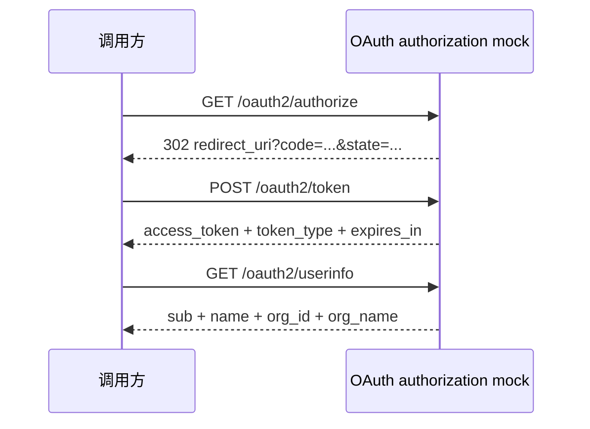

# OAuth authorization mock 场景契约

- 状态：`提议中`
- 日期：2026-10-22
- 关联：[Post-v1 开发路线](post-v1-roadmap.md)、[`ctx` API 契约](../docs/contracts/ctx-api.md)、[ADR 0001](adr/0001-no-shared-state-in-v1.md)、[ADR 0016](adr/0016-v1-ctx-pending-capabilities-deferred.md)、[ADR 0019](adr/0019-host-crypto-api.md)、[ADR 0020](adr/0020-fallback-route-and-method-mismatch.md)、[ADR 0021](adr/0021-v2-shared-state.md)

本文是维护者使用的场景契约，不属于 `docs/contracts/` 中的 Stunt Double 公开契约。实现完成后的公开运行说明放在 `demo/oauth-authorization-mock/README.md`。

本文档定义一个完全独立的 mock 服务实现契约，不依赖任何外部文档、仓库或真实身份系统。文中未使用任何真实组织、域名、应用、账号、密钥、路径或错误码。

## 1. 目标

实现一个可独立运行的、受限的 OAuth 2.0 authorization code mock，用于验证客户端在以下完整链路中的行为：

```text
浏览器/测试客户端
  -> Authorization endpoint /oauth2/authorize
  -> 回调地址接收一次性授权码
  -> Token endpoint /oauth2/token
  -> Userinfo endpoint /oauth2/userinfo
```

mock 必须能独立完成授权、换取令牌和读取用户信息，不访问任何外部网络。本场景只覆盖 authorization code 子集，并在 `token` 与 `userinfo` 上叠加 mock 专用的请求签名；它不宣称完整 OAuth 2.0 或 OIDC 兼容。

### 1.1 必须实现

- `GET /oauth2/authorize`
- `POST /oauth2/token`
- `GET /oauth2/userinfo`
- 一次性授权码
- Mock 专用 HTTP 请求签名校验
- Bearer access token 校验
- 固定 JSON 错误响应

### 1.2 明确不实现

- 用户登录界面和真实用户认证
- refresh token 与令牌刷新
- 注销、单点登出和会话管理
- 动态客户端注册
- OIDC Discovery、JWKS 和 ID Token
- PKCE
- 多租户隔离
- 持久化存储

## 2. 术语

| 术语 | 含义 |
| --- | --- |
| Authorization endpoint | 接收 `authorize` 请求并签发一次性授权码 |
| Token endpoint | 校验请求签名与表单，把授权码兑换为 access token |
| Userinfo endpoint | 校验请求签名与 access token，返回固定测试用户 |
| 调用方 | 发起授权或接口请求的客户端 |
| 一次性授权码 | 只能成功兑换一次令牌的短期凭据 |
| access token | 访问 `userinfo` 的 Bearer 凭据 |

## 3. 固定测试数据

以下值仅用于本契约和本地测试。

### 3.1 客户端

| 字段 | 值 |
| --- | --- |
| `client_id` | `demo-client` |
| `client_secret` | `demo-client-secret` |
| 允许的回调地址 | `http://127.0.0.1:18081/callback` |

### 3.2 签名配置

| 字段 | 值 |
| --- | --- |
| `key_id` | `mock-key-01` |
| `signing_secret` | `demo-signing-secret` |
| 签名版本 | `1` |

### 3.3 测试用户

| 字段 | 值 |
| --- | --- |
| `sub` | `u-10001` |
| `name` | `Alice` |
| `org_id` | `org-10` |
| `org_name` | `Example Org` |

### 3.4 网络约定

| 项目 | 值 |
| --- | --- |
| mock 监听地址 | `127.0.0.1:18080` |
| mock 基础地址 | `http://127.0.0.1:18080` |
| 回调服务监听地址 | `127.0.0.1:18081` |
| 回调地址 | `http://127.0.0.1:18081/callback` |

## 4. 授权流程



### 4.1 授权阶段

1. 调用方向 Authorization endpoint 发送 `GET /oauth2/authorize`。
2. Authorization endpoint 校验 `client_id`、`redirect_uri`、`response_type` 和 `state`。
3. 校验通过后生成一次性授权码，有效期 60 秒。
4. Authorization endpoint 返回 `302`，把 `code` 和经过查询参数百分号编码的 `state` 追加到 `redirect_uri`。调用方解码后必须得到原始 `state` 值。
5. 调用方从回调请求中读取 `code`，用于换取令牌。

授权码规则：

- 长度为 64 个 ASCII 字符。
- 仅包含小写十六进制字符。
- 每次授权请求生成不同值。
- 成功兑换一次后立即失效。
- 超过 60 秒或从未签发过，均视为无效。

### 4.2 令牌阶段

1. 调用方向 Token endpoint 发送 `POST /oauth2/token`。
2. Token endpoint 先校验请求签名，再校验表单。
3. 校验通过后使授权码失效，并签发 access token。
4. access token 有效期 300 秒。

### 4.3 用户信息阶段

1. 调用方携带 `Authorization: Bearer <access_token>` 请求 `GET /oauth2/userinfo`。
2. Userinfo endpoint 校验请求签名和 access token。
3. 校验通过后返回固定测试用户。

## 5. 通用 HTTP 约定

### 5.1 请求头

除授权跳转外，`token` 和 `userinfo` 请求必须包含：

```http
X-Sig-Key-Id: mock-key-01
X-Sig-Request-Id: <32 位小写十六进制>
X-Sig-Timestamp: <Unix 秒>
X-Sig-Version: 1
X-Sig-Signature: <64 位小写十六进制>
```

同一请求中：

- `X-Sig-Request-Id` 必须是 16 个随机字节的十六进制编码，共 32 个字符。
- `X-Sig-Timestamp` 必须是十进制 Unix 秒，不得包含小数。
- `X-Sig-Version` 固定为 `1`。
- `X-Sig-Signature` 必须是 HMAC-SHA256 的小写十六进制结果，共 64 个字符。
- 相同 `X-Sig-Request-Id` 在 10 分钟内不得重复使用。

### 5.2 时间容差

服务端接受的时间范围为 `abs(server_time - X-Sig-Timestamp) <= 300` 秒。

超出范围时返回：

```json
{
  "error": "invalid_signature",
  "error_description": "signature timestamp is outside the allowed window"
}
```

### 5.3 响应格式

除 §7.1 的 `302` 跳转外，所有成功和错误响应均满足：

- 使用 `Content-Type: application/json; charset=utf-8`。
- JSON 使用 UTF-8 编码。
- 错误响应体固定包含字符串字段 `error` 和 `error_description`。
- 不返回 HTML 错误页。
- 不返回未经约定的额外字段。

`302` 跳转不带 JSON Body，响应头以 §7.1 为准。

### 5.4 表单编码

`/oauth2/token` 只接受：

```http
Content-Type: application/x-www-form-urlencoded
```

不接受 JSON Body。表单编码使用 UTF-8 和标准 percent-encoding；同名参数重复出现时取第一个值。

## 6. 签名算法

### 6.1 规范字符串

签名原文由 6 行组成，每行以单个 LF（`0x0a`）分隔，最后一行后不追加 LF：

```text
METHOD
PATH
CANONICAL_QUERY
TIMESTAMP
REQUEST_ID
SHA256_HEX(BODY)
```

各字段定义：

| 字段 | 规则 |
| --- | --- |
| `METHOD` | 大写 HTTP 方法，如 `POST`、`GET` |
| `PATH` | 不含主机、查询参数和片段的请求路径 |
| `CANONICAL_QUERY` | 规范化查询串；无查询参数时为空字符串 |
| `TIMESTAMP` | 与 `X-Sig-Timestamp` 完全相同的字符串 |
| `REQUEST_ID` | 与 `X-Sig-Request-Id` 完全相同的字符串 |
| `SHA256_HEX(BODY)` | 原始请求 Body 的 SHA-256 小写十六进制；无 Body 时对空字节序列计算 |

### 6.2 查询串规范化

`CANONICAL_QUERY` 规则：

1. 按参数名和参数值分别做 UTF-8 percent-encoding。
2. 编码字母只使用大写十六进制：`A-F`、`0-9`。
3. 空格编码为 `%20`，不使用 `+`。
4. 参数按编码后的名称升序排序。
5. 名称相同时，按编码后的值升序排序。
6. 每项格式为 `name=value`，项之间用 `&` 连接。
7. 没有查询参数时使用空字符串。

示例：

```text
原始查询: access_token=abc&client_id=demo-client
规范查询: access_token=abc&client_id=demo-client
```

### 6.3 计算步骤

```text
body_hash = lowercase_hex(sha256(raw_body))
canonical = METHOD + "\n"
          + PATH + "\n"
          + CANONICAL_QUERY + "\n"
          + TIMESTAMP + "\n"
          + REQUEST_ID + "\n"
          + body_hash
signature = lowercase_hex(hmac_sha256(signing_secret, canonical))
```

### 6.4 签名校验顺序

服务端按以下顺序处理，任一失败立即返回：

1. 检查 5 个签名头是否齐全。
2. 检查头格式、长度和字符集。
3. 检查 `X-Sig-Key-Id` 是否等于 `mock-key-01`。
4. 检查 `X-Sig-Version` 是否等于 `1`。
5. 检查时间戳容差。
6. 检查 `X-Sig-Request-Id` 是否在 10 分钟内重放。
7. 重新计算签名，使用常量时间比较。
8. 记录本次 `X-Sig-Request-Id` 为已使用。

### 6.5 签名计算示例

示例请求：

```http
POST /oauth2/token HTTP/1.1
X-Sig-Key-Id: mock-key-01
X-Sig-Request-Id: 11111111111111111111111111111111
X-Sig-Timestamp: 1700000000
X-Sig-Version: 1
X-Sig-Signature: 0f9053612f617b27e91b1343746156654a3922917ee08b4700b7346eb445aa29
Content-Type: application/x-www-form-urlencoded

grant_type=authorization_code&client_id=demo-client&client_secret=demo-client-secret&code=0123456789abcdef0123456789abcdef0123456789abcdef0123456789abcdef&redirect_uri=http%3A%2F%2F127.0.0.1%3A18081%2Fcallback
```

中间值：

```text
METHOD=POST
PATH=/oauth2/token
CANONICAL_QUERY=
TIMESTAMP=1700000000
REQUEST_ID=11111111111111111111111111111111
BODY_SHA256=b86744e23c28f274d9eeb2f55db53dda7d98d7b6d575b600b46a31c7805522b4
```

规范字符串：

```text
POST
/oauth2/token

1700000000
11111111111111111111111111111111
b86744e23c28f274d9eeb2f55db53dda7d98d7b6d575b600b46a31c7805522b4
```

计算：

```text
signature = lowercase_hex(hmac_sha256("demo-signing-secret", canonical))
          = 0f9053612f617b27e91b1343746156654a3922917ee08b4700b7346eb445aa29
```

实现方必须使用上例的 Body、规范字符串和密钥独立算出相同的 `X-Sig-Signature`。若结果不同，应优先检查换行符、Body 字节内容和十六进制大小写。

## 7. 接口契约

### 7.1 GET /oauth2/authorize

#### 查询参数

| 参数 | 必填 | 规则 |
| --- | --- | --- |
| `response_type` | 是 | 必须为 `code` |
| `client_id` | 是 | 必须为 `demo-client` |
| `redirect_uri` | 是 | 必须与登记值完全相同 |
| `state` | 是 | 1 到 128 个可见 ASCII 字符 |

#### 成功响应

```http
HTTP/1.1 302 Found
Location: http://127.0.0.1:18081/callback?code=<64_HEX>&state=<ENCODED_STATE>
Cache-Control: no-store
```

`state` 必须按查询参数规则编码；调用方解码后应得到原始值。响应不得包含 `access_token`，不得提前返回用户信息。

#### 失败响应

参数校验失败返回 `400 invalid_request`。若 `redirect_uri` 未通过校验，不得跳转到该地址。

### 7.2 POST /oauth2/token

#### 请求头

```http
Content-Type: application/x-www-form-urlencoded
X-Sig-Key-Id: mock-key-01
X-Sig-Request-Id: <32_HEX>
X-Sig-Timestamp: <UNIX_SECONDS>
X-Sig-Version: 1
X-Sig-Signature: <64_HEX>
```

#### 表单参数

| 参数 | 必填 | 规则 |
| --- | --- | --- |
| `grant_type` | 是 | 必须为 `authorization_code` |
| `client_id` | 是 | 必须为 `demo-client` |
| `client_secret` | 是 | 必须为 `demo-client-secret` |
| `code` | 是 | 64 位小写十六进制，未过期且未使用 |
| `redirect_uri` | 是 | 必须与授权阶段使用的值完全相同 |

#### 成功响应

```http
HTTP/1.1 200 OK
Content-Type: application/json; charset=utf-8
Cache-Control: no-store
Pragma: no-cache
```

```json
{
  "access_token": "at-0123456789abcdef0123456789abcdef",
  "token_type": "Bearer",
  "expires_in": 300
}
```

access token 规则：

- 长度为 35 个 ASCII 字符。
- 固定以 `at-` 开头。
- 后 32 位为小写十六进制。
- 每次成功换取令牌都生成不同值。
- 有效期 300 秒。

#### 失败响应

- 签名错误：`401 invalid_signature`
- 参数缺失或参数格式错误：`400 invalid_request`
- 客户端凭据错误：`401 invalid_client`
- code 无效、过期或已使用：`400 invalid_grant`
- `redirect_uri` 与授权阶段不一致：`400 invalid_grant`

### 7.3 GET /oauth2/userinfo

#### 请求头

```http
Authorization: Bearer <ACCESS_TOKEN>
X-Sig-Key-Id: mock-key-01
X-Sig-Request-Id: <32_HEX>
X-Sig-Timestamp: <UNIX_SECONDS>
X-Sig-Version: 1
X-Sig-Signature: <64_HEX>
```

#### 查询参数

无。查询参数不参与业务逻辑，但参与签名规范化。

#### 成功响应

```http
HTTP/1.1 200 OK
Content-Type: application/json; charset=utf-8
Cache-Control: no-store
```

```json
{
  "sub": "u-10001",
  "name": "Alice",
  "org_id": "org-10",
  "org_name": "Example Org"
}
```

#### 失败响应

- 缺少或格式错误的 Bearer 头：`401 invalid_token`
- access token 无效或过期：`401 invalid_token`
- 签名错误：`401 invalid_signature`

## 8. 错误响应

### 8.1 结构

```json
{
  "error": "<ERROR_CODE>",
  "error_description": "<HUMAN_READABLE_DESCRIPTION>"
}
```

### 8.2 错误码

| HTTP | `error` | 场景 |
| --- | --- | --- |
| 400 | `invalid_request` | 缺少参数、重复参数冲突、格式错误 |
| 400 | `invalid_grant` | code 无效、过期、已使用或回调不匹配 |
| 401 | `invalid_client` | `client_id` 或 `client_secret` 错误 |
| 401 | `invalid_signature` | 签名缺失、格式错误、超时、重放或不匹配 |
| 401 | `invalid_token` | Bearer token 缺失、无效或过期 |
| 403 | `forbidden` | 客户端或用户无权访问 |
| 404 | `not_found` | 路径不存在 |
| 405 | `invalid_method` | 方法不允许，同时返回 `Allow` 头 |
| 500 | `server_error` | mock 内部错误；不得把脚本异常、堆栈或内部地址放进响应 |

### 8.3 错误优先级

同一请求存在多个错误时，按以下顺序返回第一个：

1. 路由不存在。
2. HTTP 方法错误。
3. 签名错误。
4. 请求格式或参数错误。
5. 凭据、授权码或令牌错误。
6. 权限错误。
7. 内部错误。

## 9. 状态机

### 9.1 授权码

```text
absent -> issued -> consumed
             |
             +-> expired
```

| 当前状态 | 事件 | 结果 |
| --- | --- | --- |
| absent | authorize 成功 | issued |
| issued | token 校验通过 | consumed |
| issued | 超过 60 秒 | expired |
| consumed | token 请求 | invalid_grant |
| expired | token 请求 | invalid_grant |

### 9.2 access token

```text
absent -> active -> expired
```

有效期为 300 秒。mock 不实现撤销和刷新。

### 9.3 签名请求 ID

```text
absent -> accepted
```

已接受的 `X-Sig-Request-Id` 保留 10 分钟；期间再次出现即视为重放并返回 `invalid_signature`。

## 10. Mock 行为规则

### 10.1 必须

- 对 `token` 和 `userinfo` 校验签名。
- 对 `authorize` 不校验签名。
- 对每次请求读取原始 Body 计算 SHA-256，不先解析再重新编码。
- 使用常量时间比较签名。
- 授权码成功兑换后立即删除或标记为已使用。
- access token 使用不可预测的随机值。
- 错误响应不使用 HTML。
- 日志不得记录 `client_secret`、授权码、access token 和签名密钥。

### 10.2 不得

- 不得接受真实生产凭据。
- 不得访问任何外部网络。
- 不得从环境变量读取真实密钥作为默认值。
- 不得把 code、access token 或签名密钥写入持久化文件。
- 不得自动重试或跟随外部重定向。
- 不得为 OAuth 增加与 Route 流水线平行的服务层、专用引擎或第二套执行路径。

## 11. curl 示例

以下示例展示请求形状。签名值需要按第 6 节实时计算。

### 11.1 发起授权

```bash
curl -i \
  'http://127.0.0.1:18080/oauth2/authorize?response_type=code&client_id=demo-client&redirect_uri=http%3A%2F%2F127.0.0.1%3A18081%2Fcallback&state=state-123'
```

预期：

```http
HTTP/1.1 302 Found
Location: http://127.0.0.1:18081/callback?code=<64_HEX>&state=state-123
```

### 11.2 换取令牌

```bash
BODY='grant_type=authorization_code&client_id=demo-client&client_secret=demo-client-secret&code=<64_HEX>&redirect_uri=http%3A%2F%2F127.0.0.1%3A18081%2Fcallback'
TIMESTAMP="$(date +%s)"
REQUEST_ID="$(openssl rand -hex 16)"
BODY_SHA256="$(printf '%s' "$BODY" | sha256sum | cut -d' ' -f1)"
CANONICAL="POST
/oauth2/token

${TIMESTAMP}
${REQUEST_ID}
${BODY_SHA256}"
SIGNATURE="$(printf '%s' "$CANONICAL" | openssl dgst -sha256 -hmac 'demo-signing-secret' -hex | sed 's/^.*= //')"

curl -i \
  -X POST 'http://127.0.0.1:18080/oauth2/token' \
  -H 'Content-Type: application/x-www-form-urlencoded' \
  -H 'X-Sig-Key-Id: mock-key-01' \
  -H "X-Sig-Request-Id: ${REQUEST_ID}" \
  -H "X-Sig-Timestamp: ${TIMESTAMP}" \
  -H 'X-Sig-Version: 1' \
  -H "X-Sig-Signature: ${SIGNATURE}" \
  --data-binary "$BODY"
```

### 11.3 读取用户信息

```bash
ACCESS_TOKEN='<ACCESS_TOKEN>'
TIMESTAMP="$(date +%s)"
REQUEST_ID="$(openssl rand -hex 16)"
EMPTY_SHA256="$(printf '' | sha256sum | cut -d' ' -f1)"
CANONICAL="GET
/oauth2/userinfo

${TIMESTAMP}
${REQUEST_ID}
${EMPTY_SHA256}"
SIGNATURE="$(printf '%s' "$CANONICAL" | openssl dgst -sha256 -hmac 'demo-signing-secret' -hex | sed 's/^.*= //')"

curl -i \
  'http://127.0.0.1:18080/oauth2/userinfo' \
  -H "Authorization: Bearer ${ACCESS_TOKEN}" \
  -H 'X-Sig-Key-Id: mock-key-01' \
  -H "X-Sig-Request-Id: ${REQUEST_ID}" \
  -H "X-Sig-Timestamp: ${TIMESTAMP}" \
  -H 'X-Sig-Version: 1' \
  -H "X-Sig-Signature: ${SIGNATURE}"
```

## 12. 测试用例

| 编号 | 场景 | 期望 |
| --- | --- | --- |
| A01 | authorize 参数完整 | 302，回跳带 64 位 code |
| A02 | authorize 的 `client_id` 错误 | 400 `invalid_request` |
| A03 | authorize 的 `redirect_uri` 未登记 | 400，且不跳转 |
| A04 | authorize 缺少 `state` | 400 `invalid_request` |
| A05 | 有效 code 换 token | 200，返回 Bearer token |
| A06 | 同一 code 第二次换 token | 400 `invalid_grant` |
| A07 | code 超过 60 秒 | 400 `invalid_grant` |
| A08 | token 的 `redirect_uri` 不匹配 | 400 `invalid_grant` |
| A09 | token 的 `client_secret` 错误 | 401 `invalid_client` |
| A10 | token 使用 JSON Body | 400 `invalid_request` |
| A11 | token 缺少签名头 | 401 `invalid_signature` |
| A12 | token 签名错误 | 401 `invalid_signature` |
| A13 | token 时间戳超差 | 401 `invalid_signature` |
| A14 | 重复 `X-Sig-Request-Id` | 401 `invalid_signature` |
| A15 | userinfo 使用有效 token | 200，返回固定测试用户 |
| A16 | userinfo 缺少 Bearer | 401 `invalid_token` |
| A17 | userinfo 使用过期 token | 401 `invalid_token` |
| A18 | userinfo 签名错误 | 401 `invalid_signature` |
| A19 | 未知路径 | 404 `not_found` |
| A20 | 错误方法 | 405 `invalid_method`，带 `Allow` |

## 13. 验收清单

- [ ] `/oauth2/authorize` 能签发一次性 code 并保留 `state`。
- [ ] `/oauth2/token` 只接受表单 Body。
- [ ] `/oauth2/token` 先校验签名，再处理 OAuth 参数。
- [ ] `/oauth2/token` 成功响应只含 `access_token`、`token_type`、`expires_in`。
- [ ] `/oauth2/userinfo` 只接受 `Authorization: Bearer <token>`。
- [ ] `/oauth2/userinfo` 返回 `sub`、`name`、`org_id`、`org_name`。
- [ ] 授权码 60 秒过期且只能使用一次。
- [ ] access token 300 秒过期。
- [ ] 时间戳容差为 300 秒。
- [ ] 签名请求 ID 在 10 分钟内拒绝重放。
- [ ] 所有错误均为 JSON，无 HTML。
- [ ] 错误码只使用本文第 8 节定义的值。
- [ ] 错误响应不包含 `request_id` 等契约外字段；`X-Request-ID` 只作为响应头用于诊断。
- [ ] 日志不含密钥、code 和 access token。
- [ ] 服务不读取外部生产配置、不访问外部网络。
- [ ] 所有 Route 继续遵循 `match → source → transform → response`。

## 14. 一致性要求

实现方必须以本文为准，不得从其他系统、文档或环境中推断字段、路径、错误码或命名。本文中的值全部是测试 fixture，不表示任何真实环境。
